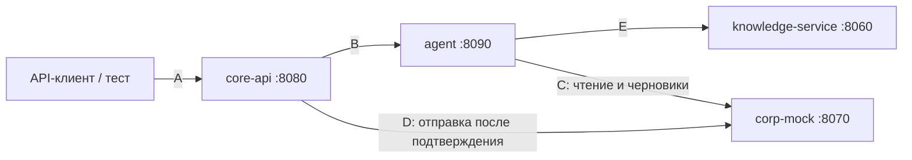

# Контракты между сервисами

Единый источник схем запросов и ответов (задача G0.1). Примеры к ним лежат в [`fixtures/`](../fixtures/README.md), тестовые данные — в [`data/`](../data/README.md).

| Контракт | Граница | Файл | Транспорт |
|---|---|---|---|
| A | API-клиент ↔ core-api | [a_core_api.yaml](a_core_api.yaml) | REST, OpenAPI 3.1 |
| B | core-api ↔ agent | [b_agent.yaml](b_agent.yaml) | REST, OpenAPI 3.1 |
| C | agent ↔ corp-mock | [c_mcp_tools.yaml](c_mcp_tools.yaml) | MCP, streamable HTTP `/mcp` |
| D | core-api ↔ corp-mock | [d_corp_rest.yaml](d_corp_rest.yaml) | REST, OpenAPI 3.1 |
| E | agent ↔ knowledge-service | [e_knowledge.yaml](e_knowledge.yaml) | REST, OpenAPI 3.1 |

Общие типы (идентификаторы, статусы, ошибка, заявка) — в [common.yaml](common.yaml).

## Общие правила

- **Ошибки** у всех сервисов в одном формате: `{"error": {"code": "...", "message": "..."}}`. Коды: `unauthorized` (401), `forbidden` (403), `not_found` (404), `conflict` (409), `validation` (422), `rate_limited` (429), `unavailable` (503), `internal` (500). `message` — текст для пользователя на русском, без технических деталей.
- **Состояние сервиса**: `GET /health` → `{"status": "ok", "service": "<имя>", "version": "..."}` у каждого сервиса.
- **Авторизация**: `Authorization: Bearer <JWT>`, HS256, секрет `JWT_SECRET`, поля `sub` (id пользователя), `login`, `role`, `team_id`, `exp`. Токен выдаёт core-api. Агент пересылает токен пользователя в knowledge-service и corp-mock и не добавляет его в промпт.
- **Права** берутся только из проверенного токена. Текст сообщения и вывод LLM роль или команду не меняют. Каждый сервис проверяет права сам.
- **Сквозной идентификатор**: заголовок `X-Request-Id` передаётся по всей цепочке.
- **Время**: даты `YYYY-MM-DD`, моменты времени — RFC 3339 с часовым поясом. Текущее время и часовой пояс агент получает от core-api (`now`, `timezone` в контракте B).
- **Идемпотентность**: создание черновика (`idempotency_key` в инструментах C) и отправка заявки (`Idempotency-Key` в A и D) при повторе с тем же ключом возвращают тот же результат и не создают второе действие.
- **Действия**: агент создаёт только черновик. Заявку отправляет core-api после подтверждения пользователем.

## Решения, принятые при фиксации

Их стоит подтвердить командой; до тех пор схемы и заглушки работают так.

1. Поиск возвращает готовый объект `source` (`doc_id`, `chunk_id`, `title`, `section`) — агент переносит его в ответ без изменений.
2. `chunk_id` = `<doc_id>#<якорь>`. Якорь задаётся в заголовке раздела документа: `## Отгул {#day-off}`. Так идентификатор не меняется при правке текста.
3. Чужой документ по идентификатору — `403 forbidden` без названия и других сведений. Чужая карточка действия в контракте A — `404`, неотличимо от несуществующей.
4. Агент ничего не хранит. Незаконченный диалог (например, уточнение даты отгула) он возвращает в поле `state`; core-api сохраняет его и присылает в следующем запросе.
5. Если агент недоступен, core-api отвечает `200` со `status: degraded` или `error` и понятным текстом. Если при подтверждении недоступен corp-mock — `503`, карточка остаётся черновиком, запрос можно повторить.
6. Заявка на доступ: статус `approved` ещё не означает, что доступ есть. Выдачу показывают `fulfilled_at` у заявки и `status: granted` в `access_list_my`.
7. Сценарий «вопрос наставнику» в контракты не входит — его нет в текущем плане.

## Как менять контракт

1. Поправь схему в `contracts/` и примеры в `fixtures/`.
2. Запусти `make contracts` — проверка сверит примеры со схемами, а идентификаторы в них с тестовыми данными.
3. Запусти `make smoke` — заглушки отдадут обновлённые примеры, а проверка пройдёт их по сети.
4. Предупреди тех, кто пользуется контрактом с другой стороны.
