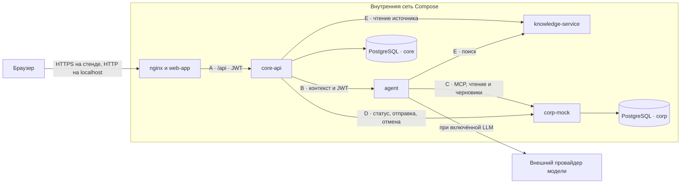

# Архитектура AI-buddy и корпоративные интеграции (L2)

## Сервисы и границы доверия

В базовом [Compose](../../docker-compose.yml) наружу выведен вход `web-app`, привязанный к localhost. nginx отдаёт SPA и проксирует `/api` в core-api. Для отдельного HTTPS-стенда есть [дополнение Compose](../../docker-compose.https.yml), а для прямой локальной отладки сервисов — [debug-дополнение](../../docker-compose.debug.yml).

| Компонент | Что делает и где хранит данные |
|---|---|
| `web-app` | React и типизированный клиент контракта A. JWT хранится в `sessionStorage`, профиль заново читается из `/api/me`. При выходе и `401` сессия очищается. |
| `core-api` | Вход, план адаптации, чат и его контекст, карточки действий, уведомления и события метрик. Данные сохраняются в схеме `core`. |
| `agent` | Выбирает сценарий, вызывает разрешённые инструменты и возвращает ответ, источники, состояние диалога и ссылки на черновики. Состояние между запросами хранит core-api. |
| `knowledge-service` | Загружает синтетические документы из `KB_DIR`. Применяет ограничения видимости по команде и роли и при поиске, и при чтении по ID. |
| `corp-mock` | Имитирует справочник, отгулы и доступы. Хранит черновики, заявки и результаты операций в схеме `corp`. |

Core-api выпускает JWT HS256 после тестового входа и на защищённых маршрутах сверяет `sub`, логин, роль и команду с профилем в БД. Knowledge-service и corp-mock проверяют подпись, срок действия и права на своей стороне. Агент получает токен пользователя для вызовов C и E. Текст запроса, документы и вывод модели не дают дополнительных прав. JWT и ключ провайдера остаются за пределами промпта. Текст вопроса, нужный контекст и результаты инструментов могут передаваться настроенной внешней модели, поэтому в демонстрации используются синтетические данные. Режим по умолчанию работает по правилам и обходится без внешней модели.

## Контракты и API интерфейса

| Контракт | Участники и назначение |
|---|---|
| [A](../../contracts/a_core_api.yaml) | Браузер → core-api. Вход, профиль, адаптация, история и отправка сообщений, карточки, уведомления, источники и метрики. |
| [B](../../contracts/b_agent.yaml) | Core-api → agent, `POST /v1/chat`. Контекст пользователя, время, состояние диалога → ответ, источники и черновики. |
| [C](../../contracts/c_mcp_tools.yaml) | Agent → corp-mock, MCP Streamable HTTP `/mcp`. Чтение и создание черновиков. |
| [D](../../contracts/d_corp_rest.yaml) | Core-api → corp-mock, REST `/api/v1/requests/{request_id}` и `submit`/`cancel`. Контракт также описывает `approve`/`reject` для согласующего. |
| [E](../../contracts/e_knowledge.yaml) | Agent → knowledge-service, `POST /v1/search`. Core-api → knowledge-service, `GET /v1/documents/{doc_id}` с JWT читателя. |

- **B1** `GET /api/knowledge/documents/{doc_id}` открывает источник по правам читателя. Для чужого документа возвращается `403` без текста, для отсутствующего — `404`, для недоступного поиска — `503`. Ответ помечается `Cache-Control: no-store`.
- **B2** `PATCH /api/notifications/{notification_id}` с `{"read":true}` сохраняет прочтение. Чужая и отсутствующая запись дают одинаковый `404`.
- **B3** `POST /api/metrics/events` принимает клиентские события начала сценария, открытия источника и обращения за помощью. Подтверждение и результат операции фиксирует сервер по сохранённому состоянию. В событиях хранятся идентификаторы прохождения и время, без полного диалога и токенов.
- **B4** `POST /api/chat/messages` поддерживает `Idempotency-Key`. Тот же ключ и текст возвращают сохранённый ход, другой текст с тем же ключом даёт `409`. Если запись сообщения есть, а ответа ещё нет, сервер продолжает тот же ход с прежним `request_id`.

`X-Request-Id` связывает запрос браузера и вызовы между сервисами. Примеры тел и ошибок лежат в [fixtures](../../fixtures/README.md). Для проверки контрактов на запущенных сервисах используется `make integration`.

## Инструменты MCP и права

Каждый вызов инструмента выполняется от имени пользователя с его JWT. Corp-mock определяет профиль по токену и применяет права к пользователю, команде и ресурсу.

| Инструмент | Разрешённое действие |
|---|---|
| `directory_get_me` | Прочитать собственный профиль, команду, наставника и руководителя. |
| `directory_find_contact` | Найти общие контакты и контакты своей команды по темам `accesses`, `absence` или `onboarding`. |
| `absence_get_rules` | Прочитать тестовые правила отсутствия. |
| `absence_list_my` | Прочитать собственные заявки на отсутствие. |
| `absence_create_draft` | Создать собственный черновик, если даты и длительность допустимы по правилам. |
| `access_list_my` | Прочитать собственные доступы, обязательные системы и статусы заявок. |
| `access_create_draft` | Создать собственный черновик для доступной пользователю системы. Уже выданный доступ или ожидающая заявка блокируют новую. |

Инструменты модели ограничены поиском и разрешёнными для сценария вызовами MCP. Отправка и отмена идут через REST от владельца. Согласовать или отклонить отправленную заявку может назначенный руководитель той же команды. Самосогласование запрещено.

## Подтверждение, повторы и восстановление

1. Агент вызывает MCP для создания черновика и возвращает его внешний ID. Core-api сохраняет карточку с этим ID вместе с ответом.
2. После явного подтверждения в интерфейсе браузер отправляет `POST /api/actions/{action_id}/confirm`. Core-api проверяет владельца и состояние карточки, затем отправляет черновик через контракт D. Ключ повтора сохраняется на время попытки, а corp-mock возвращает сохранённый результат повторной отправки.
3. Если ответ отправки потерялся, core-api читает состояние по внешнему ID. Если исход выяснить не удалось, интерфейс показывает ошибку или неизвестный исход, а повтор использует тот же ключ. Чтение открытых заявок сверяет статусы с corp-mock.
4. Согласование отгула и выдача доступа имеют разные условия завершения. Для доступа требуется `fulfilled_at`. После подтверждённой выдачи core-api обновляет связанную задачу и уведомление.

## Подключение настоящих корпоративных систем

Сохраните контракты C и D на границе адаптера. MCP-часть может обращаться к каталогу сотрудников, HR-системе и системе управления доступами. REST-часть должна читать и менять те же заявки. В Compose точки подключения задают `AGENT_MCP_URL` и `CORE_CORP_MOCK_URL`.

1. Сопоставьте `sub`, команду и роль проверенного пользователя с корпоративной учётной записью. Сервисные учётные данные для HR и управления доступами держите в адаптере. Сам адаптер проверяет владельца, допустимую систему и согласующего перед вызовом внешнего API.
2. Сохраните устойчивое сопоставление `external_id` с корпоративным ID и семантику повторов. Если внешняя система поддерживает ключ повтора, передавайте стабильный ключ. Иначе обеспечьте сохранение результата и сверку по корреляционному ID до повторной отправки.
3. Отобразите состояния согласования и выдачи по фактам из внешней системы. Для асинхронных операций возвращайте актуальное состояние при чтении D. Заполняйте `fulfilled_at` после подтверждения выдачи со стороны системы доступа.
4. Прогоните C и D на тестовом окружении поставщика. Проверьте запрет чужой операции, повтор после потери ответа, отказ, восстановление статуса и переход задачи после выдачи. Сверьте ответы с [примерами контрактов](../../fixtures/README.md).

В репозитории есть синтетические учётные записи, общий HS256-секрет для локального стенда и имитация корпоративных операций. Перед интеграцией нужно согласовать корпоративную аутентификацию, правила передачи данных во внешнюю модель и допустимые операции для сервисных аккаунтов. Маршрут управляемых сбоев corp-mock предназначен для тестового окружения.
