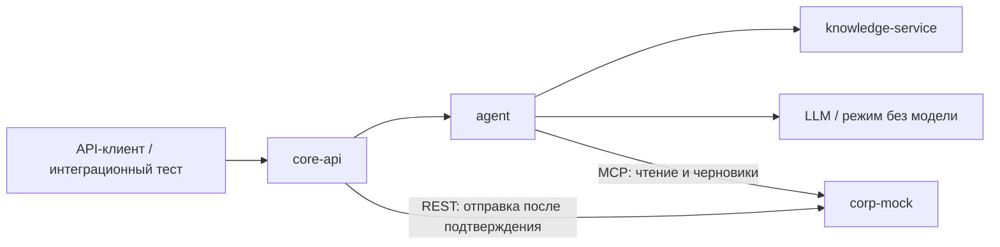

# ML и ядро AI-buddy: сервисы, задачи и порядок сборки

Текущий план разработки, согласованный 11 ноября 2026 года.

**Работаем по задачам, без закреплённого распределения на роли. Сейчас разрабатываем ML и ядро программы. Интерфейс, визуальное оформление, презентацию и видео выносим на следующий этап.**

Статус: план работ. Перечисленные сервисы, API и команды предстоит реализовать; наличие этого документа не означает их готовность. Более ранние материалы в `docs/team/prompts/` используются как технический контекст. При расхождении приоритетов и распределения работы руководствуемся этим планом.

## 1. Границы сервисов

| Сервис | Ответственность | Основной результат |
|---|---|---|
| `agent` | Понимание запроса, уточнения, выбор инструментов, работа с LLM, формирование ответа | Ответ, источники, предложения действий и следующие шаги |
| `knowledge-service` | Загрузка документов, проверка прав, поиск по базе знаний | Разрешённые фрагменты документов и источники |
| `core-api` | Авторизация, история, адаптация, карточки действий, подтверждение и сохранение результата | Состояние пользователя и управляемое выполнение действий |
| `corp-mock` | Функциональная имитация корпоративных сервисов: справочник, отгулы, доступы | Сохранённые черновики и заявки, их статусы |

Первоначально используем готовую LLM; обучение собственной модели не является зависимостью первой версии. Адаптер LLM, обработка намерений и сборка ответа остаются модулями внутри `agent`. Поиск выделяется из первоначально описанного агента в самостоятельный `knowledge-service`.

Независимость разработки обеспечивают согласованные контракты и заглушки. Объединение означает подключение сервисов друг к другу в Docker Compose: границы сервисов сохраняются, следующая волна расширяет работающую систему.

## 2. Волны разработки

- **Волна 1:** рабочий путь «запрос → поиск инструкции → черновик отгула → подтверждение → сохранённый результат», сначала без LLM; простые следующие шаги адаптации.
- **Волна 2:** подключение LLM, полноценные ответы по знаниям, запрос доступов.
- **Волна 3:** улучшение качества, восстановление после сбоев, напоминания и итоговая проверка.

Проверки прав, защита от повторных действий и тесты появляются вместе с функциями первой волны. Третья волна расширяет проверки и обработку сложных отказов.

## 3. Общий старт G0

| ID | Задача | Конкретный результат |
|---|---|---|
| **G0.1** | Зафиксировать контракты | Схемы запросов и ответов для чата, поиска, инструментов и действий. Названия полей, статусы и ошибки согласованы |
| **G0.2** | Подготовить общие тестовые данные | Два пользователя из разных команд, несколько документов, задачи адаптации и примеры заявок с постоянными идентификаторами |
| **G0.3** | Подготовить заглушки зависимостей | Каждый сервис может получить заранее заданный успешный ответ, отказ в доступе и ошибку соседнего сервиса |
| **G0.4** | Поднять каркас запуска | Четыре сервиса запускаются через Docker Compose, имеют проверку состояния и отдельные команды тестирования |

После G0 можно одновременно начинать задачи всех четырёх сервисов.

### Контракты, которые фиксируем в G0.1

Предлагаемое единое место схем — `contracts/`, примеров запросов и ответов — `fixtures/`. Это будущие каталоги, которые создаются в рамках G0.

| Контракт | Граница | Что фиксируем |
|---|---|---|
| A | API-клиент ↔ core-api | Сообщения, адаптация, карточки, подтверждение и история действий; позднее этот же API использует интерфейс |
| B | core-api ↔ agent | Проверенный контекст, история, ответ, источники, предлагаемые действия |
| C | agent ↔ corp-mock | Названия MCP-инструментов, аргументы, результаты и ошибки |
| D | core-api ↔ corp-mock | Отправка, отмена и получение статуса заявки |
| E | agent ↔ knowledge-service | Поисковый запрос → разрешённые фрагменты с `doc_id`, `chunk_id`, текстом и источником |

Контракты A–D уже описаны в общем контексте старых промптов. Их переносим в единый источник и уточняем для текущего плана; контракт E добавляем. Промпты должны ссылаться на актуальные схемы, чтобы не поддерживать разные версии вручную.

Для каждого контракта готовим примеры успешного ответа, пустого результата, отказа в доступе и недоступности зависимости. Одни и те же примеры используются заглушками и проверками настоящих сервисов.

Общие правила:

- Идентификаторы пользователей, задач, документов и заявок согласованы во всех тестовых данных.
- Права берутся из проверенной авторизации. Текст сообщения и вывод LLM не меняют роль или команду пользователя.
- Недоступные документы исключаются до поиска. Получение документа по ссылке или идентификатору также проверяет права.
- Для относительных дат агент получает текущее время и часовой пояс от backend.
- Создание черновика и отправка заявки используют устойчивые ключи идемпотентности: повтор запроса не создаёт второе действие.
- Все данные синтетические; документы базы знаний помечены как тестовые инструкции, не являющиеся регламентами Авито.

## 4. Микросервис agent

Понимает запрос и управляет диалогом: решает, что нужно пользователю, обращается к поиску и инструментам, формирует ответ. История и заявки сохраняются другими сервисами.

| ID | Задача | Результат и критерий готовности | Волна |
|---|---|---|---|
| **A1** | Реализовать входной API агента | `POST /v1/chat` принимает сообщение, историю и контекст; проверяет формат; возвращает ответ по общей схеме | 1 |
| **A2** | Собрать контекст пользователя | Агент получает команду, неделю стажировки, текущие задачи, время и часовой пояс. Авторизационные токены не попадают в промпт | 1 |
| **A3** | Сделать обработку запросов без LLM | По правилам распознаёт «что делать дальше» и «оформить отгул». Уточняет недостающие даты, включая продолжение диалога | 1 |
| **A4** | Сделать единый механизм вызова инструментов | Агент вызывает поиск, справочник и создание черновика через заменяемые клиенты. Каждый клиент работает и с заглушкой, и с настоящим сервисом | 1 |
| **A5** | Сформировать структурированный ответ | Возвращает текст, проверяемые источники, карточку черновика и следующие шаги. При ошибке инструмента не сообщает об успешном действии | 1 |
| **A6** | Подключить настоящую LLM | Модель использует тот же механизм инструментов. Заданы предел числа вызовов и общий таймаут; режим без модели остаётся доступен | 2 |
| **A7** | Добавить сценарии вопросов и доступов | Поддерживаются вопросы по базе знаний, поиск недостающих доступов и подготовка заявки. При недостатке сведений агент уточняет запрос | 2 |
| **A8** | Собрать проверку качества агента | Один запуск проверяет выбор инструментов, корректность источников, отказы и устойчивость к инструкциям внутри документов. Сохраняется отчёт | 3 |

Для A6 проверяем случай: инструмент уже создал черновик, а LLM после этого упала. Упрощённый режим использует существующий результат, чтобы не создать второй черновик.

**Можно делать параллельно:** после фиксации схем — сборку контекста, обработку намерений и клиенты инструментов. Для сборки ответа достаточно готовых примеров результатов.

## 5. Микросервис knowledge-service

Находит разрешённые знания и возвращает фрагменты документов. Итоговый ответ пользователю формирует `agent`.

| ID | Задача | Результат и критерий готовности | Волна |
|---|---|---|---|
| **K1** | Сделать загрузчик документов | Читает документы и метаданные: идентификатор, заголовок, команду или роль доступа, дату обновления. Некорректные документы выявляются при загрузке | 1 |
| **K2** | Разбить документы на фрагменты | Каждый фрагмент имеет постоянный идентификатор, ссылку на документ и заголовок раздела; сохраняется связь с исходным текстом | 1 |
| **K3** | Реализовать ограничения доступа | Из поиска заранее исключаются недоступные документы. Та же проверка работает при запросе документа по идентификатору | 1 |
| **K4** | Реализовать базовый поиск | Поиск по словам, например BM25, возвращает наиболее подходящие разрешённые фрагменты. Для нерелевантного запроса может вернуть пустой результат | 1 |
| **K5** | Предоставить API поиска и документов | `/v1/search` возвращает фрагменты и источники; получение документа проверяет авторизацию. Контракт работает независимо от агента | 1 |
| **K6** | Расширить базу и подготовить проверочные вопросы | Есть материалы по выбранным сценариям и набор вопросов с ожидаемыми документами, включая вопросы без ответа и запреты по правам | 2 |
| **K7** | Улучшить поиск по результатам проверок | Измеряется попадание нужных документов в первые результаты; исправляются найденные ошибки поиска и порога релевантности | 3 |

Эмбеддинги и гибридный поиск можно добавить внутри K7, если базовый поиск показывает недостаточное качество. Для первой сборки они не являются зависимостью.

**Можно делать параллельно:** загрузчик, разбиение текста, правила доступа и поиск — на заранее согласованных структурах документов и фрагментов. Подготовка контента идёт независимо от реализации поиска.

## 6. Микросервис core-api

Хранит состояние и обеспечивает выполнение действий. Это точка входа для тестового клиента, а позже — для интерфейса. Здесь находятся история, задачи адаптации и подтверждения.

| ID | Задача | Результат и критерий готовности | Волна |
|---|---|---|---|
| **C1** | Подготовить хранение данных | Миграции и загрузка тестовых данных для пользователей, задач, сообщений и действий. Повторная загрузка не создаёт дубли | 1 |
| **C2** | Реализовать тестовую авторизацию и права | Пользователь определяется по проверенному токену. Чужие сообщения, задачи и заявки недоступны | 1 |
| **C3** | Реализовать состояние адаптации | API возвращает этапы, задачи, прогресс и 1–3 следующих шага. Приоритеты рассчитываются понятными правилами без LLM | 1 |
| **C4** | Реализовать обработку и хранение чата | Сообщение сохраняется, агент получает контекст и историю, ответ сохраняется. При недоступности агента возвращается понятный результат с признаком ошибки или упрощённого режима | 1 |
| **C5** | Реализовать жизненный цикл карточки действия | Предложенный агентом черновик сохраняется. Подтверждение и отмена проверяют владельца и допустимость перехода статуса | 1 |
| **C6** | Обеспечить безопасные повторы и сохранение результата | Повтор подтверждения не создаёт новую заявку. Если ответ корпоративного сервиса потерялся, система выясняет результат операции перед повтором | 1 |
| **C7** | Синхронизировать статусы и задачи | Изменения заявки попадают в историю и связанную задачу. Запрос доступа переводит задачу в работу, выдача доступа — в выполненные | 2 |
| **C8** | Добавить напоминания | Просроченные задачи создают уведомления, доступные через API. Повтор запуска планировщика не создаёт одинаковые уведомления | 3 |
| **C9** | Добавить события и диагностику | По `request_id` можно проследить запрос; фиксируются изменения статусов, ошибки и длительность обращений. Секреты не записываются в логи | 3 |

Для C6 защита от повторов работает совместно с `corp-mock`. Одна блокировка повторного запроса в `core-api` не решает ситуацию, когда корпоративный сервис выполнил действие, а ответ потерялся.

Изменения задач, предложенные агентом, проходят проверку владельца и допустимости операции в `core-api`. Отправленная заявка на доступ не означает, что доступ уже получен: завершение связанной задачи требует подтверждения выдачи.

**Можно делать параллельно:** логику адаптации, обработку чата и жизненный цикл действий. Они используют согласованные интерфейсы хранения; настоящую БД в локальных тестах можно заменять тестовым хранилищем.

## 7. Микросервис corp-mock

Исполняет корпоративные операции. Это функциональная имитация внешних систем: она действительно сохраняет заявки и меняет их статусы.

| ID | Задача | Результат и критерий готовности | Волна |
|---|---|---|---|
| **T1** | Создать модель заявки и переходов статусов | Есть черновик, отправленная, согласованная, отклонённая и отменённая заявка. Недопустимые переходы отклоняются | 1 |
| **T2** | Реализовать проверку прав | Каждая операция проверяет пользователя и принадлежность заявки. Стажёр не может согласовать собственную заявку или получить чужую | 1 |
| **T3** | Реализовать справочник | Можно получить свой профиль и разрешённый контакт по теме: доступы, отгулы, адаптация | 1 |
| **T4** | Реализовать операции отгула | Получение тестовых правил, создание черновика, проверка дат, отправка, отмена и чтение статуса работают с сохранением данных | 1 |
| **T5** | Предоставить MCP и REST | Агент через MCP читает данные и создаёт черновики; `core-api` через REST отправляет их после подтверждения. Повторы операций обрабатываются идемпотентно | 1 |
| **T6** | Реализовать операции доступов | Возвращается список необходимых и имеющихся доступов; можно создать и отправить заявку на разрешённую систему | 2 |
| **T7** | Реализовать изменение статусов | Согласование и выдача доступа отражаются в данных сервиса. Для тестов предусмотрен управляемый способ пройти эти переходы | 2 |
| **T8** | Добавить управляемые сбои | Можно воспроизвести задержку, отказ и потерю ответа после выполнения операции, чтобы проверить восстановление всей системы | 3 |

**Можно делать параллельно:** модель заявок, политики доступа, справочник и бизнес-логику отгулов. MCP- и REST-обработчики можно писать поверх заглушек этих функций.

## 8. Порядок интеграции

| Сборка | Какие задачи входят | Что обязательно проходит |
|---|---|---|
| **0. Каркас** | G0.1–G0.4 | Все сервисы запускаются; тестовый запрос проходит по согласованным контрактам |
| **1. Первое рабочее ядро** | A1–A5, K1–K5, C1–C6, T1–T5 | Следующий шаг адаптации; оформление отгула от запроса до сохранённого результата; повтор подтверждения; отказ в доступе |
| **2. Полное ядро выбранных сценариев** | Предыдущая сборка + A6–A7, K6, C7, T6–T7 | Ответы с источниками и запрос доступов; работа с LLM и без неё; корректные статусы |
| **3. Проверенное ядро** | Предыдущая сборка + A8, K7, C8–C9, T8 | Проверки качества, напоминания, восстановление после сбоев, отсутствие повторных действий и утечек в проверочных сценариях |

### Приёмка первой рабочей сборки

Запрос пользователя → уточнение → инструкция с источником → черновик → подтверждение → отправка в `corp-mock` → сохранённый результат в истории. После перезапуска история сохраняется. Повтор подтверждения не создаёт вторую заявку. Пользователь другой команды не получает закрытые документы и чужие заявки.

Проверку выполняем через API-клиент или интеграционный тест. Полноценный интерфейс на этом этапе не требуется.

На интеграционных проверках используем настоящие реализации четырёх сервисов. Заглушки остаются для независимой разработки и воспроизводимого моделирования ошибок. Внутри волны подключаем готовые части постепенно, не откладывая все проверки стыков до её окончания.

## 9. Готовность задачи и правила работы

Каждую задачу считаем законченной, когда:

- Описаны её вход, выход и ожидаемое поведение; для AI-функций есть SDD-спецификация до реализации.
- Реализация проверена локально, включая характерную ошибку.
- Соблюдён общий контракт; его примеры проходят проверку реализации.
- Задачу можно проверить без готовности соседнего сервиса.
- Изменения готовы к включению в общую сборку.

Тесты добавляются вместе с задачами каждой волны. Покрытие строк прикладного кода должно превышать 80% согласно кейсу; нужен воспроизводимый отчёт. Третья волна расширяет проверки всей системы, а не впервые добавляет тесты или защиту.

Рабочие правила:

1. Участник берёт конкретную задачу по её ID. Постоянное распределение на роли не требуется.
2. Если зависимость не готова, используем заглушку по согласованному контракту.
3. Изменение контракта сопровождается обновлением схемы, примеров и проверок; потребители получают совместимую версию либо согласованное изменение.
4. Общая сборка после каждой волны остаётся рабочей. Незавершённое расширение включается отдельным флагом.
5. Интеграция проверяет законченный пользовательский путь; одних проверок состояния сервисов недостаточно.

## 10. Что брать первым

После общего старта первый набор параллельных задач: **A2–A4, K1–K4, C1–C3, T1–T4**. A1 завершает полноценный входной API агента поверх каркаса G0.4; разработку остальных частей это не блокирует при зафиксированном контракте.

Задачи распределяются между участниками по мере освобождения. Зависимости подключаются через согласованные заглушки, готовые части постепенно входят в первую общую сборку.

Всего: **36 задач** — 4 общие, 8 для `agent`, 7 для `knowledge-service`, 9 для `core-api`, 8 для `corp-mock`.
