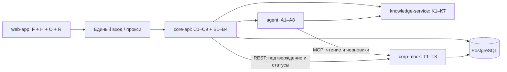

# Завершение AI-buddy: сервисы, задачи и порядок сборки

Срез репозитория и таблицы: **13 ноября 2026, Europe/Moscow**. Основа плана — `main` на `7c72f6073fa312294ec784fc55181512fc212f6d`, [план ML и ядра](01_ML_CORE_BACKLOG.md), контракты A–E и требования кейса «AI-buddy» (с. 7–14).

**55 новых задач до завершения.** T1–T8 влиты в main 13 ноября ([PR #15](https://github.com/OfficeKlerk/Avito-ML-helper-/pull/15)), на момент среза были в работе. Это план работы, а не подтверждение готовности или оценка трудозатрат: задачи неодинаковы по размеру. Исходные 36 задач остаются со своими ID; после дополнения общий список содержит 91 задачу. Исполнителей новых задач команда выбирает сама, постоянных ролей нет.

[Общая таблица команды](https://docs.google.com/spreadsheets/d/1_OHLj6SwdmZ7gTf7_x5VTZZN34V-YTPByOV_8RJu4B0/edit): исходные задачи и новые блоки на том же листе. Столбцы — задача, кто делает, статус; подробности и зависимости — в примечании задачи. «Готово» ставим после проверки критерия и включения в общую ветку.

## 1. Что уже есть и что переносим из ML-плана

| Часть | Состояние на момент планирования | Что делать дальше |
|---|---|---|
| G0.1–G0.4 | Контракты, данные, Compose и инструменты есть; в таблице «Готово» | Переиспользовать, не создавать второй каркас |
| agent A1–A8 | Реализация и проверки в main, в таблице «Готово» | Подключить ко всей цепочке; проверить живую LLM в I5 и качество в Q4 |
| knowledge-service K1–K7 | Реализация и отчёты в main, в таблице «Готово» | Подключить источники к UI через B1/H3 |
| core-api C1–C9 | В main есть хранение, чат, действия, синхронизация и напоминания; в таблице «Готово» | Добавить B1–B4 и проверить с настоящим corp-mock |
| corp-mock T1–T8 | В main после PR #15: заявки, права, справочник, отгулы, доступы, MCP/REST, управляемые сбои. Тесты с PostgreSQL проходят, отгул и доступ проходят цепочку с настоящим corp-mock | Проверить согласование и выдачу (T7) и сбои (T8) в I4 и I6; новые дубли задач не создавать |
| web-app, CI всего продукта, материалы сдачи | В проверенном дереве main отсутствуют | Реализовать задачи ниже |

Статус в таблице и наличие кода не заменяют сквозную приёмку. Новый план не объявляет все сервисы уже совместно проверенными.

### T1–T8 (готовы, нужны для сборок)

| ID | Существующая задача | Где нужна для следующей сборки |
|---|---|---|
| T1 | Модель заявок и переходов | Постоянное хранение, seed и D3 |
| T2 | Права на корпоративные операции | Все пути I1–I6, матрица Q2 |
| T3 | Справочник пользователя и контактов | Реальный агент и сценарии I2–I5 |
| T4 | Операции отгула | I3 |
| T5 | MCP/REST и идемпотентность | Первая сборка I1 |
| T6 | Операции доступов | I4 |
| T7 | Согласование и выдача | I3/I4, управляемый тестовый переход без отдельной панели HR |
| T8 | Управляемые сбои | I6 |

Для I1 требуется готовность T1–T5 вместе, для I4 — T1–T7, для I6 — T1–T8. Полные критерии T сохранены в [исходном плане](01_ML_CORE_BACKLOG.md#7-микросервис-corp-mock).

## 2. Границы независимых частей

Сохраняем четыре backend-микросервиса: `core-api`, `agent`, `knowledge-service`, `corp-mock`. Добавляем один `web-app` и входной прокси. Внутри web-app независимо разрабатываются оболочка F, чат H, адаптация O и заявки R. Они имеют свои каталоги и интерфейсы, но собираются в одно приложение: отдельный сетевой микросервис для каждого экрана не нужен.

Платформа D, интеграция I, проверки Q, метрики M и сдача L — независимые рабочие блоки, а не дополнительные backend-сервисы. Для работы впятером нужны границы кода и контракты; увеличение числа контейнеров само по себе независимость не даёт.

Браузер использует явный API-клиент и core-api, секрет LLM остаётся на сервере. Токен проверяется на стороне сервисов. MCP создаёт черновики; отправка требует явного подтверждения пользователя через core-api. Реализация corp-mock должна сохранять данные и переходы, а не выдавать фиксированный успешный ответ.

## 3. Порядок выполнения и точки интеграции

Номер Э — ближайший этап завершения задачи. Код и тесты можно начинать раньше на зафиксированном контракте. В колонке зависимостей таблиц указаны условия окончательной приёмки; для независимой разработки достаточно согласованных интерфейсов и fixtures.

| Этап | Что выполняем параллельно | Обязательный результат сборки |
|---|---|---|
| **Э1. Основа независимой работы** | S1–S3; после S1 — M1; после S2/S3 — F1/F2/F4 и заготовки H/O/R по примерам | Зафиксированы сценарии, интерфейсы компонентов, дополнения A и тестовые примеры; frontend собирается |
| **Э2. Первая общая UI-сборка** | B1/B2/B4, F3/F5, H1–H3, O1/O2/O4, R1–R3, D1/D2 | **I1 + I2:** реальные вход, адаптация, вопрос, источник и сохранённая история в браузере |
| **Э3. Все выбранные сценарии** | H4/H5, O3/O5, R4/R5, F6, B3, D3–D5, M2, L1/L2 | **I3 + I4 + I5:** отгул и доступ доходят до сохранённого результата; выдача отражается в задаче; LLM и резервный режим проверены |
| **Э4. Приёмка** | I6 с T8, D6, Q1–Q4, M3; исправления — в соответствующих модулях | **Q5:** все заявленные сценарии проходят с чистого запуска; права, повторы и покрытие подтверждены отчётами |
| **Э5. Сдача** | L3 и L4 после Q5, затем L5/L6/L7 | Проверенная версия, PDF, видео, код и инструкции доступны экспертам; сдача подтверждена |

**Первый набор для пяти участников:** ① участник, закончивший T1–T8, берёт свободную задачу Э1–Э2; ② S1/S2 и затем F; ③ S3 и затем B; ④ M1 и подготовка O по контракту; ⑤ заготовки H/R и сценарии интеграции I по fixtures. Это временные параллельные потоки, не постоянные роли. После короткой синхронизации S2/S3 свободный участник берёт конкретную H/O/R/D-задачу. Если одна задача уже занята, второй человек берёт другую строку или согласованную подзадачу.

Общие файлы `contracts/`, Compose, Makefile и lockfile меняет один участник за раз; остальные работают в своих каталогах. Каждый PR указывает ID задачи, вход/выход и проверку. Частые небольшие интеграции сохраняют рабочую общую ветку. Fixtures разрешены для разработки и моделирования ошибок; I1–I6 и финальная сдача используют настоящие реализации.

## 4. Новые задачи

### Общий старт следующих этапов

**Граница кода:** `docs/product/, contracts/, fixtures/`. Согласованные сценарии, состояния экранов и примеры API позволяют пяти участникам начинать работу независимо.

| ID | Задача | Этап | Зависимости для приёмки | Результат и критерий готовности |
|---|---|---|---|---|
| **S1** | Зафиксировать пользовательский путь и границы релиза | Э1 | — | Описаны четыре уже выбранных пути: следующий шаг адаптации, вопрос с источником, отгул/отпуск, доступ. Для каждого есть начало, успешный исход, отказ и следующий шаг. Уточнены срок и площадка сдачи у организаторов; новые HR-сценарии не добавляются. |
| **S2** | Согласовать экраны, состояния и интерфейсы UI-модулей | Э1 | S1 | Есть схема навигации и состояния входа, чата, плана, заявок, уведомлений; предусмотрены ожидание, пустота, ошибка, истёкшая сессия. Зафиксированы общие типы, props и события ChatPanel, OnboardingPanel, ActionCard и SourceViewer; модули можно разрабатывать отдельно. |
| **S3** | Зафиксировать дополнения к API до реализации | Э1 | S1 | В контракте A и fixtures описаны чтение документа через core-api, отметка уведомления, события пользы и безопасный повтор сообщения. Указаны JWT, ошибки, request_id, идемпотентность и совместимость старых клиентов. Проверка контрактов проходит; примеры доступны UI до готовности B1–B4. |

### core-api — дополнения для интерфейса

**Граница кода:** `core-api/, contracts/a_core_api.yaml, fixtures/a_core_api/`. Расширяем готовые C1–C9; повторная реализация авторизации, истории, подтверждений и планировщика не требуется.

| ID | Задача | Этап | Зависимости для приёмки | Результат и критерий готовности |
|---|---|---|---|---|
| **B1** | Добавить чтение источника через core-api | Э2 | S3, K5 | GET /api/knowledge/documents/{doc_id} пересылает JWT в knowledge-service и возвращает документ по E. Проверены 401/403/404/503, отсутствие кеша между пользователями и недоступность закрытого текста. При несовпадении версии документа UI может показать дату; контракт и тесты обновлены. |
| **B2** | Сохранять прочтение уведомлений | Э2 | S3, C8 | PATCH /api/notifications/{notification_id} принимает read=true, проверяет владельца и сохраняет результат в PostgreSQL. Повтор безопасен; чужое уведомление недоступно; отметка сохраняется после перезапуска. |
| **B3** | Добавить события для измерения пользы | Э3 | S3, M1, C9 | Учитываются начало сценария, ответ/источник, подтверждение, итог операции и обращение к человеку. Клиентские события проходят проверку схемы и дедупликацию; успешное действие фиксирует сервер по сохранённому результату. Есть обезличенный session/scenario ID и время, нет JWT, паролей и полного текста диалога. |
| **B4** | Обеспечить безопасный повтор отправки сообщения | Э2 | S3, C4, C6 | POST /api/chat/messages поддерживает Idempotency-Key: повтор того же ключа и текста не вызывает агента и создание черновика второй раз; иной текст с тем же ключом даёт конфликт. Исходное состояние и результат хранятся в БД; проверены конкуренция и потеря ответа. Старые клиенты без ключа продолжают работать по прежнему контракту. |

### web-app — оболочка и общий API-клиент

**Граница кода:** `web-app/src/app/, web-app/src/shared/, web-app/package.json`. Один React + TypeScript frontend и один артефакт сборки; feature-модули H/O/R имеют собственные каталоги и независимые тесты.

| ID | Задача | Этап | Зависимости для приёмки | Результат и критерий готовности |
|---|---|---|---|---|
| **F1** | Создать сборку React и TypeScript | Э1 | S2 | Есть web-app с маршрутизацией, lockfile, командами dev/build/typecheck/test и конфигурацией адреса API. Чистая установка и production build проходят. Браузерный bundle не содержит секретов; CI и Docker подключаются через эти команды. |
| **F2** | Сделать общие элементы интерфейса | Э1 | S2 | Готовы кнопки, поля, индикатор ожидания, сообщения ошибок, статусы, карточка и диалог подтверждения. Компоненты имеют понятные подписи, фокус и состояния disabled/loading; карточка не содержит своей бизнес-логики заявок. |
| **F3** | Реализовать вход, профиль и выход | Э2 | F1, S3, C2 | Реальный /api/auth/login, /api/me, текущая команда и роль; защищённые маршруты; очистка сессии и данных пользователя при выходе/401. Выбрана и описана стратегия хранения JWT. После смены пользователя не показывается кеш предыдущего; неверный пароль имеет понятную ошибку. |
| **F4** | Сделать типизированный API-клиент | Э1 | F1, S3 | Единый клиент для A: JWT, X-Request-Id, обработка статусов и таймаутов, AbortController, типы ответов. GET можно повторить по политике, мутации автоматически не дублируются. Клиент поддерживает идемпотентные ключи; фикстурный транспорт подключается только в тестах/локальной разработке. |
| **F5** | Собрать навигацию и общие состояния | Э2 | F2, F3, F4 | Доступны чат, адаптация, заявки и уведомления; deep links переживают обновление страницы. Есть error boundary, 404, состояние отключённой сети и возврат после входа. Единый пользовательский контекст передаётся модулям без доверия к данным клиента на сервере. |
| **F6** | Проверить адаптивность и доступность оболочки | Э3 | F5 | Оболочка и модальные окна работают при ширине 360 и 1280 px, с клавиатурой, увеличением текста и видимым фокусом. Нет горизонтального переполнения; смысл статусов понятен по тексту, а не только цвету. Проверены длинные имена и ошибки. |

### web-app/chat — диалог и источники

**Граница кода:** `web-app/src/features/chat/`. Получает ApiClient и callbacks карточек/навигации по S2; самостоятельно не вызывает agent и корпоративные сервисы.

| ID | Задача | Этап | Зависимости для приёмки | Результат и критерий готовности |
|---|---|---|---|---|
| **H1** | Показать сохранённую историю диалога | Э2 | S2, S3, F4 | История загружается из /api/chat/messages, сохраняет порядок и источники, различает user/assistant и статусы. Пустая история объясняет первый шаг. После обновления страницы видны серверные сообщения; ограничения limit соответствуют A. |
| **H2** | Реализовать отправку и ожидание ответа | Э2 | H1, B4 | Отправка вызывает core-api, показывает ожидание и не блокирует остальную навигацию. Повтор после неопределённого результата сохраняет Idempotency-Key; повторный клик не создаёт второй ход. Обрабатываются 429, таймаут, error/degraded в успешном HTTP-ответе; сообщение не объявляется доставленным до подтверждения сервера. |
| **H3** | Показать источники и чтение документа | Э2 | H1, B1 | У ответа видны название, раздел, дата и пометка тестовой инструкции; источник открывает нужный фрагмент документа через B1. Markdown и ссылки безопасно отображаются; 403/404 дают понятное сообщение без скрытого текста. Нет прямого доступа браузера к служебным секретам. |
| **H4** | Подключить карточки действий и подсказки | Э3 | H2, R1, R2, R3 | Карточки в ответе используют общий модуль R; подтверждение выполняется только после явного клика. Подсказка отправляет новый вопрос через тот же API. Обновления карточки согласованы с историей заявок; нет локальной имитации успешного результата. |
| **H5** | Проверить диалог на длинных и ошибочных ответах | Э3 | H3, H4 | Проверены длинные сообщения, лимит 4000 символов, переносы, безопасный Markdown, пустые источники, потеря сети и истечение JWT. Прокрутка не сбивает чтение старых сообщений; ожидание доступно скринридеру. Тесты покрывают реальные UI-состояния. |

### web-app/onboarding — адаптация и уведомления

**Граница кода:** `web-app/src/features/onboarding/, web-app/src/features/notifications/`. Показывает состояние C3/C7/C8 и изменяет только разрешённые сервером поля; правила приоритетов и дедлайнов остаются в core-api.

| ID | Задача | Этап | Зависимости для приёмки | Результат и критерий готовности |
|---|---|---|---|---|
| **O1** | Показать этапы, прогресс и следующие шаги | Э2 | S2, S3, F4, C3 | Экран использует /api/onboarding: этапы, текущие задачи, процент и 1–3 следующих шага с причинами. Отображаются реальные данные текущего пользователя; нет повторного расчёта бизнес-приоритетов на клиенте. |
| **O2** | Добавить работу со статусом своей задачи | Э2 | O1 | PATCH задачи отражает ответ сервера и понятную ошибку. Недоступный переход не изображается успешным; задача на доступ не завершается до подтверждения выдачи. Ссылки и сроки показаны корректно, сравнение дат учитывает Europe/Moscow. |
| **O3** | Связать задачу, чат и заявку | Э3 | O1, H2, R4 | Из задачи можно перейти к связанному действию или сформировать вопрос помощнику. После подтверждения/отмены/выдачи обновляется состояние с сервера. Возврат на экран сохраняет контекст навигации, а не устаревшую копию бизнес-данных. |
| **O4** | Показать и отмечать уведомления | Э2 | O1, B2 | Напоминания и смены статусов читаются из /api/notifications; доступны переходы к задаче/карточке и отметка прочтения. Прочтение сохраняется после перезагрузки; нет повторов одного уведомления в списке. |
| **O5** | Проверить обновление адаптации во времени | Э3 | O2, O3, O4 | При возвращении на вкладку и после действий данные обновляются; опрос останавливается при выходе/скрытой вкладке. Проверены отсутствие задач, все задачи выполнены, просрочка, начало новой даты, ошибка обновления и другая команда. |

### web-app/actions — заявки и результаты

**Граница кода:** `web-app/src/features/actions/`. Единые карточки для чата и истории. API core-api является источником статуса; согласование выполняется в corp-mock по T7.

| ID | Задача | Этап | Зависимости для приёмки | Результат и критерий готовности |
|---|---|---|---|---|
| **R1** | Показать карточку черновика | Э2 | S2, S3, F2, F4 | Показаны тип действия, даты/система, поля, текущий статус, external_id при наличии. Все данные берутся из ActionCard; неизвестное поле не теряется. Компонент можно подключить к H и к списку без готового чата. |
| **R2** | Реализовать явное подтверждение без повторов | Э2 | R1, C6 | POST confirm отправляется с одним стабильным Idempotency-Key для попытки, сохраняемым до выяснения исхода. Двойной клик и повтор после таймаута не меняют ключ; UI читает текущий статус и показывает серверный результат. Проверены 409/503 и состояние ожидания. |
| **R3** | Реализовать отмену и ошибки переходов | Э2 | R1, C5 | Отмена вызывает API для допустимых состояний; конфликт обновляет карточку с сервера. Отказ, недоступность и отменённая заявка имеют разные сообщения; действия недоступны, пока операция выполняется. |
| **R4** | Сделать историю и обновление статусов заявок | Э3 | R2, R3, C7 | Список /api/actions и экран конкретной карточки переживают reload; открытые заявки обновляются ограниченным опросом. Согласование не объявляется выдачей доступа: отображаются результат сервера и подтверждённое состояние связанной задачи. После выхода опрос и кеш очищаются. |
| **R5** | Проверить весь интерфейс действий | Э3 | R4 | UI-тесты проходят для черновика, отправки, согласования, выдачи, отказа, отмены, недоступности и неизвестного исхода. Одна карточка в чате и истории отображает согласованное состояние; повторные клики не приводят к новым операциям. |

### platform — запуск, входной прокси и CI

**Граница кода:** `infra/, docker-compose.yml, Makefile, .github/workflows/, web-app/Dockerfile`. Расширяем существующий Compose. Нужен один вход для браузера; отдельные Kubernetes, Kafka, Redis и сервис авторизации для сдачи не требуются.

| ID | Задача | Этап | Зависимости для приёмки | Результат и критерий готовности |
|---|---|---|---|---|
| **D1** | Подключить web-app к Docker Compose | Э2 | F1 | Собирается production frontend, добавлен healthcheck и запуск вместе с существующими сервисами. Используются реальные upstream по умолчанию; devkit stubs остаются отдельным профилем. Неполная конфигурация даёт понятную ошибку. |
| **D2** | Настроить единый вход и маршруты браузера | Э2 | D1, F4 | Прокси отдаёт SPA и направляет /api в core-api; deep links и статические файлы работают. JWT и request_id передаются корректно, таймауты учитывают LLM; agent/knowledge/БД не публикуются как публичные API. На публичном стенде включён HTTPS; локально достаточно localhost. |
| **D3** | Сделать воспроизводимую конфигурацию и хранение | Э3 | D2, T1 | Закреплены зависимости, .env.example без секретов, версии и требования к ресурсам. Миграции/seed повторяемы; данные сохраняются в volumes. Reset тестового состояния — явная команда с защитой от рабочего окружения; перезапуск не стирает заявки. |
| **D4** | Добавить автоматические проверки в CI | Э3 | F1, I1 | CI выполняет проверку контрактов, Python/Go/TS-тесты, lint/typecheck/build и интеграцию с PostgreSQL. DB-тесты не могут незаметно пропускаться. Отчёты покрытия и логи сохраняются как артефакты; доступ к платной LLM нужен только отдельному явно включённому прогону. |
| **D5** | Подготовить диагностику и ограничения внешних вызовов | Э3 | D2, C9 | Документированы health, просмотр логов по request_id, таймауты и режим без LLM. Проверено, что логи и браузер не раскрывают ключи. Управляемые сбои T8 доступны только тестовому окружению; для опубликованного стенда ограничены вход/частота запросов и расходы модели. |
| **D6** | Проверить развёртывание и восстановление на чистом окружении | Э4 | D3, D4, D5, I6 | Новый checkout запускается по README одной описанной последовательностью; фиксируется версия образов/коммита. Проверены остановка/повторный старт, сохранность данных и возврат к предыдущей рабочей версии. Хостинг допускается локальный или командный сервер; облачный аккаунт не является зависимостью. |

### integration — сборки всего продукта

**Граница кода:** `integration/, fixtures/, docs/testing/`. Проверки подключают настоящие реализации всех четырёх сервисов, БД и затем UI. Они дополняют существующие smoke по заглушкам.

| ID | Задача | Этап | Зависимости для приёмки | Результат и критерий готовности |
|---|---|---|---|---|
| **I1** | Проверить контракты всех сервисов в общей сборке | Э2 | T5, B1, B2, B4 | Общие данные и настоящий JWT проходят A–E; Python MCP-клиент работает с реализацией corp-mock. Проверены миграции, ошибки, таймауты и совместимость источников. Ни один рабочий URL сборки не указывает на stub; отдельно сохраняется команда контрактных тестов. |
| **I2** | Собрать путь входа, адаптации и ответа с источником | Э2 | I1, F5, H3, O2, D2 | Через браузер пользователь входит, видит свою команду и следующие шаги, задаёт вопрос, открывает источник и после reload видит историю. Пользователь второй команды получает свой набор данных. Сборка имеет воспроизводимый сценарий проверки. |
| **I3** | Собрать отгул от сообщения до сохранённого результата | Э3 | I2, H4, R4, T4, T7 | Пользователь уточняет дату, видит черновик, явно подтверждает; corp-mock сохраняет отправку, core-api сохраняет результат и историю. Отмена/отказ доступны через предусмотренные API. Перезапуск и повтор подтверждения не создают дубль; результат виден в интерфейсе. |
| **I4** | Собрать выдачу доступа и завершение связанной задачи | Э3 | I2, O3, R4, T6, T7 | От вопроса о недостающем доступе проходит создание/подтверждение заявки и контролируемое согласование/выдача через T7. Только подтверждённая выдача завершает задачу. Проверены уже выданный доступ, ожидающая заявка и запрос системы другой команды. |
| **I5** | Проверить живую LLM и резервный режим на тех же путях | Э3 | I3, I4, A6 | С указанным провайдером/моделью и ключом из окружения выполняются реальные запросы. При сбое/таймауте работает предусмотренный режим без LLM; черновик, уже созданный инструментом, не создаётся повторно. Сохранён отчёт с версией модели, сценариями, задержками и ограничениями. |
| **I6** | Проверить сбои и восстановление всей цепочки | Э4 | I3, I4, I5, T8, O4 | Воспроизведены отказ, задержка и потеря ответа после действия, перезапуск core/corp и обновление браузера. Состояние восстанавливается без дублей и ложного успеха; уведомления и история согласованы. Проверка сама поднимает/убирает отдельные тестовые данные и сохраняет диагностический отчёт. |

### quality — приёмка и исправления

**Граница кода:** `web-app/tests/, integration/, docs/testing/reports/`. Каждый разработчик пишет проверки вместе со своей задачей; здесь проверяется качество всего продукта и собираются доказательства сдачи.

| ID | Задача | Этап | Зависимости для приёмки | Результат и критерий готовности |
|---|---|---|---|---|
| **Q1** | Собрать воспроизводимый отчёт покрытия всего прикладного кода | Э4 | D4, H5, O5, R5, B3 | Учтены Go, Python и TypeScript, включая новый frontend/corp и новые B-модули. Отчёт содержит покрытые/всего строк по компонентам и взвешенный итог, превышающий 80%; арифметическое среднее процентов не используется. Исключения только для зависимостей, генерации и тестов; отчёт можно повторить командой. |
| **Q2** | Проверить права, инъекции и защиту данных | Э4 | I4, I5, H5 | Матрица двух команд и ролей проверяет чужие документы, задачи, историю, уведомления и заявки, подмену JWT/JSON, самосогласование. Проверены prompt injection в документе и XSS в сообщении/ссылке, отсутствие секретов в клиенте и логах. Найденные дефекты исправлены и покрыты регрессией. |
| **Q3** | Измерить скорость и удобство реального интерфейса | Э4 | I6, F6 | На описанном устройстве измерены простые локальные действия с ориентиром <1 с и отдельно длительность серверных/LLM-запросов; зафиксированы выборка и условия. Долгое ожидание не блокирует экран, показан статус. Проверены 360/1280 px, клавиатура, ошибки, длинный контент; дефекты исправлены. |
| **Q4** | Проверить качество ответов на новых вопросах | Э4 | I5, K7, A8 | Заморожен новый независимый набор выбранных сценариев, с правами и вопросами без ответа. Оценены правильность ответа, достаточность и фактическое использование источников, отсутствие выдуманного успеха. Отчёт разделяет первый прогон и регрессию после исправлений; старые 60 вопросов не выдаются за новую независимую оценку. |
| **Q5** | Пройти итоговую приёмку и закрыть блокирующие дефекты | Э4 | Q1, Q2, Q3, Q4, D6 | Составлен реестр дефектов, исправлены все, мешающие заявленным сценариям, безопасности, запуску или сохранности. Человек, не писавший соответствующий модуль, проходит сценарии по инструкции на чистом окружении. Зафиксированы отчёты и допустимые ограничения; один healthcheck не считается приёмкой. |

### product-metrics — польза и проверка эффекта

**Граница кода:** `docs/product/, scripts/metrics/`. Используем события B3/C9 и обезличенный отчёт, без отдельного сервиса аналитики и доступа к реальным данным сотрудников.

| ID | Задача | Этап | Зависимости для приёмки | Результат и критерий готовности |
|---|---|---|---|---|
| **M1** | Определить метрики пользы и план эксперимента | Э1 | S1 | Для сценариев заданы время до результата, доля успешно завершённых действий, повторные обращения к наставнику и оценка полезности. У каждой метрики есть числитель/знаменатель, начало/конец, источник и базовый способ сравнения. Уменьшение нагрузки наставника описано как проверяемая гипотеза. |
| **M2** | Сделать расчёт метрик по сохранённым событиям | Э3 | M1, B3, I3 | Скрипт строит агрегированный отчёт: воронка, завершения/ошибки и длительности. Сценарии не дублируются при ретраях, тестовые/резервные режимы помечены. Нет персональных диалогов в выгрузке; расчёт проверен на известных входных данных. |
| **M3** | Провести пробный пользовательский прогон и описать выводы | Э4 | M2, I4, Q3 | Участники или приглашённые тестировщики выполняют одинаковые задачи с помощником и по инструкции; фиксируются условия и ограничения малой выборки. Измеренные результаты отделены от прогнозов. Если стажёры недоступны, это явно отмечено и описан будущий пилот, без выдуманных исследований. |

### release — документация, видео, презентация и сдача

**Граница кода:** `README.md, docs/architecture/, docs/submission/, release/`. Это обязательные результаты хакатона, а не отдельные запущенные сервисы. Материалы описывают проверенную версию продукта.

| ID | Задача | Этап | Зависимости для приёмки | Результат и критерий готовности |
|---|---|---|---|---|
| **L1** | Обновить инструкцию запуска и проверки для жюри | Э3 | D3, I2 | README содержит версии, ресурсы, установку, переменные API/модели и подключение своего ключа, тестовые аккаунты, сценарии, тесты/coverage, reset и типовые ошибки. Все команды и ссылки проверены; .env.example не содержит секретов. |
| **L2** | Описать архитектуру и подключение корпоративных систем | Э3 | I1, S3 | Есть схема сервисов и границ доверия, A–E и новые API, хранение/права, подтверждение, идемпотентность и восстановление. Указано, как заменить corp-mock адаптерами настоящих сервисов, какие доступны MCP-инструменты и кто может их вызвать; ограничения объяснены. |
| **L3** | Подготовить продуктовую презентацию в PDF | Э5 | Q5, M3, L2 | PDF раскрывает проблему, путь стажёра, выбранные сценарии, работающий результат, архитектуру/права, интеграции, метрики и дальнейшее внедрение. Факты взяты из проверок; гипотезы обозначены. На первом слайде или в README есть рабочие ссылки на код и видео. |
| **L4** | Записать видео полного пользовательского пути | Э5 | Q5, L1 | Видео показывает настоящий интерфейс: вход, вопрос, источник, черновик, явное подтверждение и сохранённый результат; доступны адаптация и следующий шаг. Нет подменённых ответов или монтажа, скрывающего неработающий шаг. Файл/ссылка открывается у проверяющего. |
| **L5** | Провести репетицию защиты всей командой | Э5 | L3, L4 | Пять участников умеют объяснить сценарий, пользу, архитектуру, права и ограничения своего проекта. Прогнаны показ и вопросы; сохранён резервный способ запуска и сценарий при недоступной LLM. Представляется та же версия, что сдаётся. |
| **L6** | Зафиксировать и проверить комплект сдачи | Э5 | L1, L2, L3, L4, L5 | Созданы тег/commit и комплект исходников с README, lockfiles/конфигурацией, seed, SDD, тестами, отчётами покрытия, PDF и видео/ссылкой. Из чистой копии повторён запуск. Нет секретов, кешей и виртуальных окружений; для private repo проверен доступ hack-and-change-2026, либо подготовлен разрешённый ZIP. |
| **L7** | Отправить решение и подтвердить доступность | Э5 | L6 | На площадку организаторов до подтверждённого дедлайна передан PDF со ссылкой на репозиторий либо ZIP по правилам кейса. Сохранено подтверждение приёма; ссылки открываются без прав владельца. Сдаваемая версия зафиксирована, дальнейшие изменения не подменяют её. |

## 5. Покрытие требований кейса

| Требование | Задачи и доказательство |
|---|---|
| Путь стажёра и выбранные сценарии (с. 7) | S1, O1–O3, I2–I4; все четыре заявленных пути выполняются |
| Ответы о команде и инструментах с учётом контекста (с. 7) | Готовые A/K + H1–H3, I2, Q2/Q4 |
| Хотя бы одно действие через корпоративный сервис/имитацию (с. 7, 11) | T1–T7, R1–R4, I3/I4; результат отображён и сохранён |
| Этапы, статусы, следующие шаги (с. 7) | Готовые C3/C7/C8 + O1–O5 |
| Интерфейс и явный API-клиент (с. 8, 11) | F1–F6, H/O/R, D1/D2 |
| Права, синтетические данные и пометка инструкций (с. 12) | T2, B1/B2, F3, H3, Q2; реальные данные сотрудников не собираются |
| Покрытие строк >80% и воспроизводимый отчёт (с. 12) | D4, Q1, Q5, L6; учитывается frontend и весь новый прикладной код |
| SDD AI-функций (с. 8, 12) | Существующие openspec/specs сохраняются; при изменении AI-поведения спецификация обновляется до кода, отчёт Q4 привязан к версии |
| Быстрая реакция UI и неблокирующее ожидание (с. 12) | H2, F6, Q3; измерения локальных операций отдельно от LLM |
| Метрики пользы и проверка эффекта (с. 7) | M1–M3, B3, L3; измеренное отделено от гипотез |
| README, версии, аккаунты, тесты, конфигурация внешних API (с. 8–9) | D3/D6, L1/L6 |
| Продуктовая презентация PDF, видео, код и доступ экспертов (с. 8–9, 13) | L3–L7; отсутствие презентации и невозможность пройти основной путь блокируют сдачу |
| Архитектура, права, внедрение и защита (с. 7, 14) | L2/L3/L5 |

## 6. Когда работа над проектом завершена

1. T1–T8 включены в общую версию (сделано); все 55 новых задач приняты по результатам, а не по наличию файлов.
2. Из чистого окружения по README запускается интерфейс, реальные сервисы и БД; основные пути проходят без devkit-заглушек.
3. В интерфейсе подтверждённое действие имеет сохранённый результат; повтор/перезапуск не дублирует действие, другая команда не получает закрытые данные.
4. Приложены актуальные тесты, SDD и воспроизводимый отчёт покрытия >80% с учётом всех написанных компонентов. Q5 не имеет открытых блокирующих дефектов.
5. Внешняя модель настроена через окружение; проверены живая LLM и резервный режим. Ключи не включены в исходники/архив.
6. Есть проверенные PDF, видео, исходники, тестовые данные и инструкция; жюри имеет доступ; L7 подтверждает приём сдачи.

Отдельные интерфейсы наставника/HR, полная HR-система, подключение настоящих внутренних систем Авито, обязательный облачный хостинг, Kubernetes/Kafka и эмбеддинги не добавлены в обязательный объём. Их можно описать как дальнейшее развитие после работающей сдачи. Объём пересматривается, только если команда меняет заявленные сценарии или появляются новые требования организаторов.
